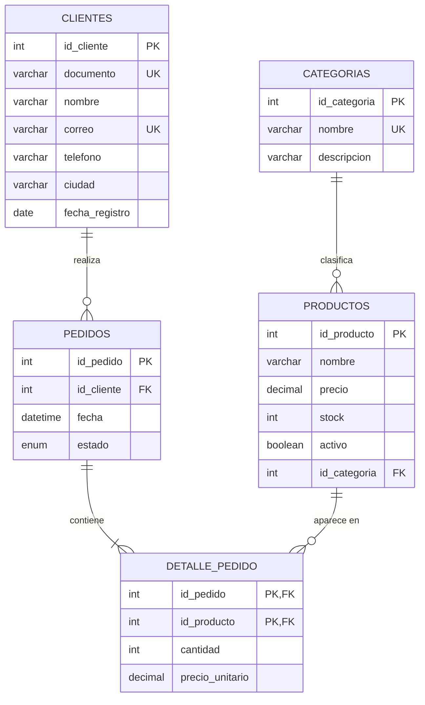

# Caso base · TecnoTienda

Caso único que atraviesa todo el recorrido: los aprendices lo **diseñan** (temas 2–3), lo **construyen** (tema 4), lo **llenan y operan** (temas 5–7), lo **consultan** (temas 8–9) y lo **conectan a una aplicación** (tema 10 y proyecto final).

## Enunciado (se entrega a los aprendices en el Tema 2)

> TecnoTienda es una tienda de tecnología en Colombia que hoy lleva sus ventas en una hoja de cálculo y quiere un sistema propio.
>
> La tienda vende **productos** (portátiles, periféricos, monitores, almacenamiento y redes). De cada producto se conoce su nombre, precio, cantidad en inventario y si está activo para la venta. Cada producto pertenece a una sola **categoría**; de la categoría interesa su nombre y una descripción.
>
> Los **clientes** se registran con documento, nombre, correo, teléfono, ciudad y fecha de registro. Un cliente puede hacer muchos **pedidos**; cada pedido es de un solo cliente y tiene fecha y estado (pendiente, pagado, enviado o cancelado).
>
> En un pedido se pueden comprar varios productos, y un mismo producto aparece en muchos pedidos. Por cada producto del pedido se guarda la cantidad y el precio al que se vendió, porque los precios cambian con el tiempo.

## DER (notación pata de gallo)

Lectura de las relaciones:
- Una categoría clasifica **cero o muchos** productos; un producto pertenece a **una** categoría.
- Un cliente realiza **cero o muchos** pedidos; un pedido es de **un** cliente.
- Un pedido contiene **uno o muchos** detalles; un producto aparece en **cero o muchos** detalles.
- `detalle_pedido` es la entidad intermedia de la N:M pedidos ↔ productos.

## Planilla desordenada (punto de partida del Tema 3)

Archivo: `sql/planilla-desordenada.csv`. Problemas sembrados a propósito:

| Problema | Dónde se ve |
|---|---|
| Celdas con varios valores (viola 1FN) | `productos`, `categoria`, `precios` |
| Cliente repetido en varias filas | Laura Gómez (3 pedidos), Andrés Ruiz (2) |
| Inconsistencias al repetir | «Laura Gómez» / «Laura Gomez», «Bogotá» / «Bogota», «Medellín» / «Medellin», `3001234567` / `300 123 4567` |
| Total calculado guardado | columna `total` (dato derivado) |
| Cantidad mezclada con el nombre | «Mouse inalámbrico x2» |

Camino de normalización esperado:
1. **1FN** → una fila por producto vendido: `(fecha, cliente, documento, telefono, ciudad, producto, categoria, cantidad, precio)`; se elimina `total` (se calcula con SQL).
2. **2FN** → separar lo que depende solo del cliente (`clientes`), solo del producto (`productos`) y del pedido (`pedidos`); queda `detalle_pedido(pedido, producto, cantidad, precio_unitario)`.
3. **3FN** → la descripción de la categoría depende de la categoría, no del producto → `categorias`.

Resultado: las 5 tablas del DER.

## Archivos SQL

| Archivo | Uso |
|---|---|
| `sql/tecnotienda-schema.sql` | Estructura final (solución del Tema 4). |
| `sql/tecnotienda-seed.sql` | Datos de prueba (solución del Tema 5; precarga desde el Tema 6). |
| `sql/planilla-desordenada.csv` | Material del Tema 3. |

Datos sembrados con casos útiles para ejercicios: cliente sin pedidos (Diego Castro), productos sin ventas (Tablet 10", Webcam HD), producto con stock 0 (Monitor 27"), producto inactivo (Webcam HD), pedidos en los 4 estados, varias ciudades repetidas, un cliente sin correo (Natalia Pardo) y otro sin teléfono (Diego Castro).

Totales por pedido (para pruebas automáticas): 1 → 2.558.900 · 2 → 309.700 · 3 → 459.800 · 4 → 3.516.700 · 5 → 1.149.000 (cancelado) · 6 → 579.800 · 7 → 2.688.900 · 8 → 888.800 · 9 → 199.500 · 10 → 839.700.

## Caso de transferencia: Biblioteca

Usado en ejercicios avanzados para comprobar que el aprendiz puede repetir el proceso solo:
planilla `prestamos_biblioteca(libro, autor, lector, tel_lector, fecha)` → 3FN: `autores`, `libros`, `libro_autor` (N:M), `lectores`, `prestamos`.
